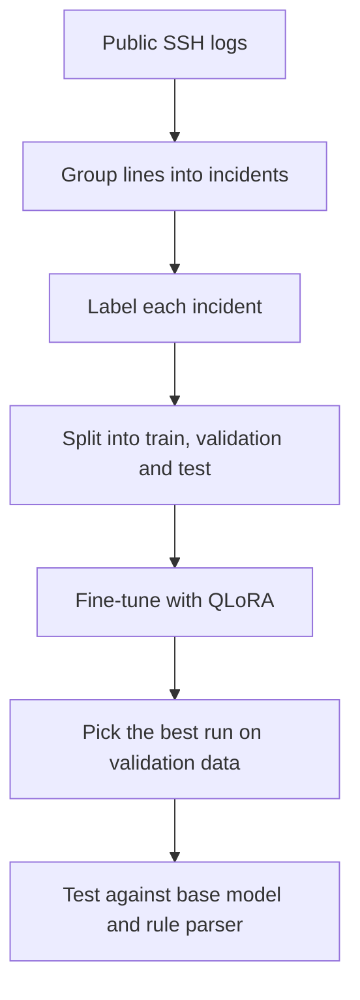
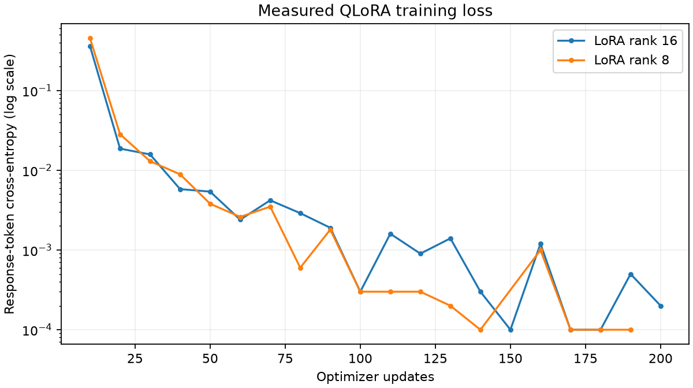

# Fine-Tuning an LLM to Read SSH Login Logs

SSH servers can record authentication attempts, accepted logins, failures and disconnects. These messages are interleaved across connections, which makes a busy log difficult to read by hand.

In this project I fine-tuned a small open-weight language model, [Qwen3-1.7B](https://huggingface.co/Qwen/Qwen3-1.7B), to read a related group of SSH log lines, called an incident, and write a short, structured summary of it: who tried to log in, where they connected from, whether they got in, what happened along the way, and which log lines prove each of those points.

The adapters were trained on a single 12 GB laptop GPU, then tested against the pretrained model without the task adapter and a rule-based parser. "Base model" means Qwen3-1.7B as released, without my adapter.

## Results at a glance

On 200 held-out incidents from the same log source, scored against the reviewed reference answers:

| | Base Qwen3-1.7B | Fine-tuned Qwen3-1.7B |
|---|---:|---:|
| Records with every field correct | 0 / 200 | 198 / 200 |
| Finding F1 (0 to 1, higher is better) | 0.265 | 1.000 |
| Answers in the required JSON format | 43 / 200 | 200 / 200 |

Training took about 30 minutes and updated 8.7 million parameters, around 0.5% of the model.

More detail is in the [full results](reports/RESULTS.md), the [200-incident test report](reports/EXTENDED_TEST_200.md) and the [methodology notes](docs/METHODOLOGY.md).

## What the model does

Here is a short, made-up incident ([examples/incident.txt](examples/incident.txt)):

```text
Nov 04 12:00:00 gateway sshd[101]: Invalid user backup-agent from 192.0.2.10
Nov 04 12:00:02 gateway sshd[101]: Failed password for invalid user backup-agent from 192.0.2.10 port 43210 ssh2
Nov 04 12:00:03 gateway sshd[101]: Connection closed by 192.0.2.10 [preauth]
```

Each line is tagged L1, L2, L3 before it goes to the model, and the model returns this:

```json
{
  "user": "backup-agent",
  "source_ip": "192.0.2.10",
  "connection_outcome": "failure",
  "findings": ["invalid_user", "password_authentication_failed", "connection_closed"],
  "evidence_line_ids": ["L1", "L2", "L3"],
  "server_hostname": "gateway"
}
```

| Field | Meaning |
|---|---|
| `user` | The account name someone tried to log in as |
| `source_ip` | The IP address the attempt came from |
| `connection_outcome` | `success`, `failure` or `unknown` |
| `findings` | Which events happened, from a fixed list of six |
| `evidence_line_ids` | The log lines that support those findings |
| `server_hostname` | The server that wrote the log |

The six possible findings are `invalid_user`, `password_authentication_failed`, `authentication_accepted`, `too_many_authentication_failures`, `connection_closed` and `insufficient_evidence`.

The labeling rules set `user`, `source_ip` and `server_hostname` to `null` when the incident lacks a supported value or contains conflicting values. Outcomes use `success`, `failure` or `unknown`; findings and evidence are lists. The task describes observable events rather than intent. Model outputs can still be wrong, so the cited lines need checking.

The real output for this example, with timing and memory use, is saved in [reports/demo_prediction.json](reports/demo_prediction.json).

## How it works, step by step



### 1. Get the data

The logs come from the [Loghub OpenSSH dataset](https://github.com/logpai/loghub/tree/master/OpenSSH), a public collection of real logs from a lab server, published for research. The download script records a SHA-256 checksum of the file so anyone rerunning the project can confirm they have the same data. The raw logs are not stored in this repository.

### 2. Group the lines into incidents

A server log mixes many connections together, line by line. Lines are grouped by server name and SSH process ID. Explicit SSH disconnect messages end a group; an idle gap longer than 30 minutes or a timestamp moving backwards starts a new one. This produced 157,611 candidate incidents. Groups longer than 32 lines were excluded before sampling. Grouping is approximate, and an incident can contain several authentication attempts.

### 3. Label each incident

Each incident needs a correct answer to train and test against. A rule-based parser ([schema.py](src/ssh_log_analysis/schema.py)) produces these answers, following a short written [labeling rubric](docs/ANNOTATION_RUBRIC.md).

Before any training, all 100 selected test answers were checked against their original log lines through tool-assisted source review and automated checks, not independent expert review. This caught two bugs in the parser: IPv4 addresses followed by a colon were being missed, and PAM authentication failures were being marked as `unknown`. Both were fixed before any model was scored.

### 4. Keep duplicate families in one split

Bots often send the same attempt over and over. If one copy ends up in the training set and a near-identical copy ends up in the test set, the test score looks better than it should. To reduce this risk, a "family" matches the server hostname and ordered messages after port numbers are normalized. Timestamps and process IDs are ignored by this comparison; usernames and IP addresses are retained. One original incident per family is kept, leaving 5,729 families, and a fixed hash assigns each to one split. Each split was also balanced so that rarer events, like successful logins, show up often enough to learn from and measure.

For training only, extra examples were created by swapping in made-up usernames, IP addresses and hostnames. After length filtering, 269 of these copies remained. They provide practice copying values outside the original identities.

After removing incidents longer than 1,024 tokens, the final splits were:

| Split | Incidents |
|---|---:|
| Training | 1,599 (1,330 real, 269 with swapped names) |
| Validation | 142 |
| Test | 93, later extended to 200 |

### 5. Fine-tune with QLoRA

Updating all the weights and optimizer states would use much more memory than adapter training. QLoRA reduces the memory needed in two ways:

- The original model is loaded in 4-bit precision (NF4) and frozen, so its weights never change and take up much less memory.
- Small trainable matrices, called LoRA adapters, are attached to the model's attention and feed-forward layers. Only these adapters are trained.

Other training choices:

- **Loss on the answer only.** The model is graded only on the JSON it writes, not on repeating the prompt (completion-only fine-tuning).
- **Memory savers.** BF16 mixed precision, gradient checkpointing, and gradient accumulation to reach an effective batch size of 8 while processing one example at a time.
- **Settings.** Learning rate 2e-4, one pass over the training data (200 optimizer steps), fixed random seed 42.
- **Same prompt everywhere.** Training, the base-model baseline and the fine-tuned model all use one shared prompt ([prompts.py](src/ssh_log_analysis/prompts.py)).



### 6. Pick the best run on validation data

I trained two adapter sizes, rank 8 and rank 16 (rank controls how many parameters the adapter has). They were compared on the validation set only. Test predictions were not used to choose between them.

| Rank | Trainable parameters | Training time | Validation records fully correct | Validation finding F1 |
|---|---:|---:|---:|---:|
| 16 | 17.4 M | 28.6 min | 141 / 142 | 0.998 |
| 8 | 8.7 M | 30.4 min | 141 / 142 | 1.000 |

Rank 8 was selected. Rank 16 had a lower validation loss, but rank 8 matched it on fully correct records and scored slightly higher on finding F1, with half the parameters.

### 7. Test it

Three systems were run on the same test incidents:

1. The base Qwen3-1.7B
2. The fine-tuned model (rank 8)
3. The rule-based parser

Both models got the same prompt and used greedy decoding without random token sampling. Any answer that wasn't valid JSON with exactly the six fields counted as wrong.

The main measurements:

- **Exact record:** all six fields are correct.
- **Finding F1:** how closely the list of events matches, penalizing both missed and extra events.
- **Evidence precision and recall:** whether the cited lines are the right ones.
- **Speed and GPU memory** for each system.

Training runs and the original and extended evaluation summaries are recorded in the local MLflow store.

## Results

The original test set had 93 incidents. I later added 107 more unused incidents from the same reserved test pool, without retraining anything, to make 200. The additional cohort contains 100 failure outcomes and seven unknown outcomes, with no successful logins. Successful-login coverage still rests on the original ten cases.

| Test set | System | Finding F1 | F1 with code fences removed | Records fully correct | Valid JSON format |
|---|---|---:|---:|---:|---:|
| Original 93 | Base model | 0.257 | 0.615 | 0 / 93 | 17 / 93 |
| Original 93 | Fine-tuned | 1.000 | 1.000 | 93 / 93 | 93 / 93 |
| All 200 | Base model | 0.265 | 0.664 | 0 / 200 | 43 / 200 |
| All 200 | Fine-tuned | 1.000 | 1.000 | 198 / 200 | 200 / 200 |

What stood out:

- **Formatting caused many strict-scoring failures for the base model.** It wrapped 157 of its 200 answers in Markdown code fences, which breaks strict JSON parsing. Stripping just those fences raises its F1 from 0.26 to 0.66. Content errors remained after that formatting change: extra events that weren't in the log, missed disconnects and wrong line numbers.
- **The fine-tuned model matched the reference findings on all 200 incidents, but two records still had a wrong identity field.** In one, a username was copied incorrectly. In the other, a destination address was reported as the source IP. F1 alone would have hidden these, which is why exact-record accuracy is tracked too. Both errors are kept in the scores.
- **Latency depended on the evaluation session.** On the matched 20-incident comparison, average answer length fell from 94 to 55.4 tokens and median time fell from 8.8 to 7.2 seconds. On the additional 107 incidents, the adapter was slower: median 9.2 seconds versus 8.8 for the base model. These runs do not establish a general speed advantage.
- **The rule parser scores 100% because it wrote the reference answers.** It's included as a reference point, and as a reminder that for a single fixed log format, a parser is far faster and cheaper than an LLM.

## Limits and next steps

All the data comes from one lab server. Log formats and some usernames and IP addresses occur across splits. Keeping families apart stops repeated attempts leaking between splits, but similar log formats still appear on both sides. The results show the model learned this labeling scheme very well. They don't yet show how it handles other servers or other log formats.

Next steps:

1. Build a harder test set from other sources and newer OpenSSH message formats, including cases the rule parser can't handle.
2. Add a few-shot prompting baseline to measure how much of the improvement needed fine-tuning.
3. Compare more training runs on that harder set: model size, learning rate and training-set size.

## Running it yourself

Use Python 3.12 and [uv](https://docs.astral.sh/uv/). Training and model inference require an NVIDIA CUDA GPU; the measured setup was Windows 11 with a 12 GB RTX 5070 Laptop GPU and PyTorch 2.8.0 / CUDA 12.8. The commands use `uv run` instead of Windows-specific executable paths, but the full locked GPU environment has only been validated on Windows. Linux needs compatible NVIDIA drivers and packages. This CUDA pipeline does not support macOS GPU training or inference. The rule parser and unit tests do not need a GPU.

### Setup

Run these commands from the repository root. Creating `.cache` first is needed by the test suite's configured temporary directory on a fresh clone.

```bash
uv sync --locked --python 3.12
uv run python -c "from pathlib import Path; Path('.cache').mkdir(exist_ok=True)"
uv run python -m ssh_log_analysis env-check   # checks Python, packages and the GPU
uv run pytest -q                              # 48 tests, no GPU needed
```

### Rerun the experiment

```bash
# 1. Download the logs, group them into incidents and build the splits
uv run python -m ssh_log_analysis prepare
uv run python -m ssh_log_analysis validate

# 2. Export the test answers for review (see the note below)
uv run python -m ssh_log_analysis audit

# 3. Quick five-step training check: confirms the adapters update and the original weights stay frozen
uv run python -m ssh_log_analysis smoke

# 4. Remove incidents over 1,024 tokens and freeze the splits
uv run python -m ssh_log_analysis filter-data

# 5. Run everything: baselines, both training runs, selection and final test
uv run python -m ssh_log_analysis run-experiment

# 6. Try the rank-8 adapter used in the reported experiment
uv run python -m ssh_log_analysis predict --file examples/incident.txt --adapter artifacts/rank-8/adapter

# 7. Browse the logged runs in MLflow at http://127.0.0.1:5000
uv run mlflow ui --backend-store-uri ./mlruns --host 127.0.0.1 --port 5000
```

The prediction example uses the adapter selected in the measured run. After a new run, check `reports/selection.json` and use the adapter path recorded there.

**About the review step.** `audit` writes `reports/audit.json` with every test incident set to `pending`. After checking an incident against its log lines, set `review_status` to `rubric_review_completed` and fill in `review_method` and `review_notes`. `run-experiment` checks that every retained test incident is marked reviewed and its answer still matches the frozen reference. Running `audit` again resets everything to `pending`.

### Individual commands

```bash
uv run python -m ssh_log_analysis evaluate --system rules --split validation --output reports/rules_validation
uv run python -m ssh_log_analysis evaluate --system model --split validation --limit 20 --output reports/development_sample
uv run python -m ssh_log_analysis train --rank 16
uv run python -m ssh_log_analysis report
```

### The 200-incident test

```bash
uv run python -m ssh_log_analysis prepare-test-extension --total 200
# Review every incident in data/test_extensions/total-200/audit.json, as above
uv run python -m ssh_log_analysis evaluate-test-extension --total 200
```

This requires a completed original experiment and its selected rank-8 adapter. It uses the existing model and settings without retraining. Predictions are saved after every incident, so an interrupted run picks up where it stopped, as long as the data, model, adapter, prompt and decoding settings haven't changed.

### Running out of GPU memory

Lower `max_length` to 512 in [configs/train.json](configs/train.json) and rerun `uv run python -m ssh_log_analysis filter-data --max-length 512`. If that isn't enough, set the config model to `Qwen/Qwen3-0.6B` and filter with `--model Qwen/Qwen3-0.6B --max-length 512`. Treat either change as a new experiment: archive the previous outputs, refilter every split for the new model and length limit, complete the reference review, and rerun baselines, training and validation-based selection. Do not combine the new scores with the existing 93- or 200-incident results.

## Repository layout

```text
src/ssh_log_analysis/
  data.py              download logs, group into incidents, build splits
  schema.py            output format and labeling rules
  prompts.py           the prompt shared by training and testing
  modeling.py          model loading, QLoRA training and inference
  evaluation.py        scoring
  experiment.py        runs the full experiment in order
  extension.py         the 200-incident test extension
  reporting.py         writes the results reports
  tracking.py          MLflow logging
  cli.py               command-line entry point
configs/train.json     training settings
tests/                 unit tests
docs/                  methodology and labeling rubric
reports/               metrics, results and training curves
examples/              the made-up example incident
```

Raw data, model weights, predictions and MLflow storage (`data/`, `artifacts/`, `mlruns/`) are not in Git. The commands regenerate these artifacts locally; annotation review is a separate required step. Hardware and software differences can change model results.

`report` regenerates `reports/RESULTS.md`, and `evaluate-test-extension` regenerates `reports/EXTENDED_TEST_200.md`. Their generated wording can replace the edited prose in this repository; preserve a copy or review the Git diff after running them.

## Credits

**Data:** [Loghub OpenSSH](https://github.com/logpai/loghub/tree/master/OpenSSH), shared for research and academic use. Check [Loghub's license](https://github.com/logpai/loghub/blob/master/LICENSE) before any other use.

> Jieming Zhu, Shilin He, Pinjia He, Jinyang Liu, Michael R. Lyu. *Loghub: A Large Collection of System Log Datasets for AI-driven Log Analytics*. ISSRE, 2023.

**Model:** [Qwen3-1.7B](https://huggingface.co/Qwen/Qwen3-1.7B), Apache-2.0, pinned to revision `70d244cc86ccca08cf5af4e1e306ecf908b1ad5e`.

**Libraries:** PyTorch, Hugging Face [Transformers](https://huggingface.co/docs/transformers/), [Datasets](https://huggingface.co/docs/datasets/), [PEFT](https://huggingface.co/docs/peft/) and [TRL](https://huggingface.co/docs/trl/), bitsandbytes and MLflow.

## License

The code is released under the [MIT License](LICENSE). The dataset and model keep their own licenses.
