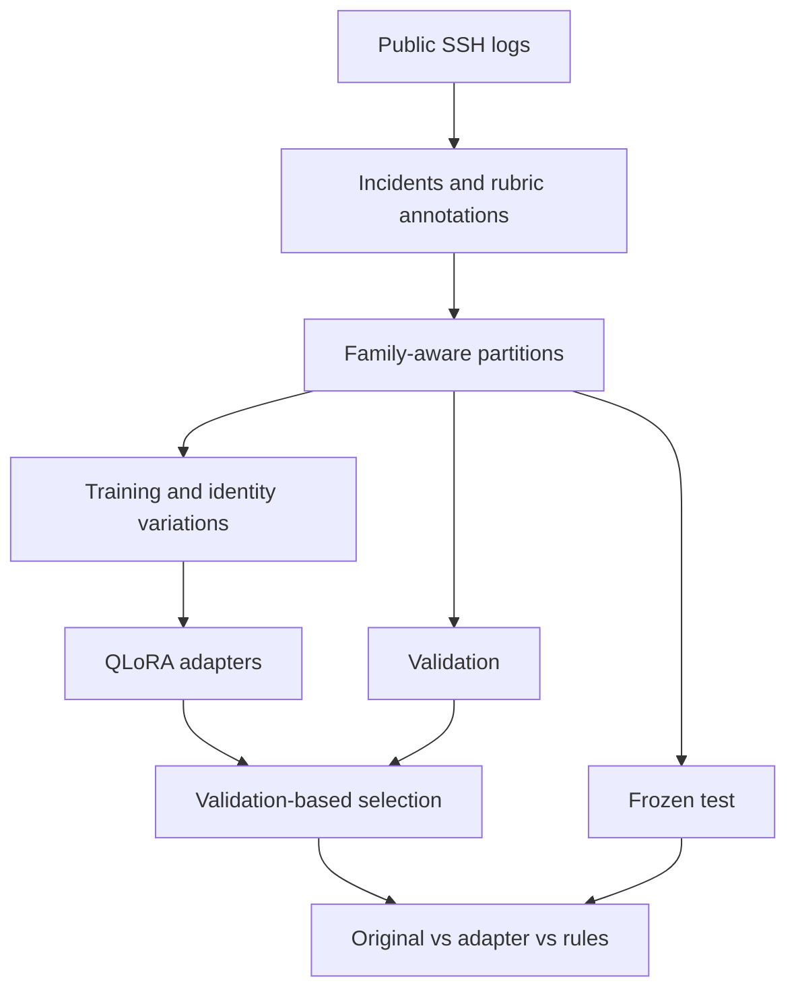

# SSH Log Fine-Tuning

A reproducible fine-tuning experiment that turns SSH authentication logs into structured summaries with exact evidence lines. It extracts who attempted to connect, the source IP, the authentication outcome, and the events supported by the logs.

Qwen3-1.7B is adapted with completion-only SFT and QLoRA on a 12 GB GPU, then compared with the original model and a deterministic parser. The experiment records dataset provenance, partition boundaries, evidence quality, and GPU costs. Rule-generated references are not independent expert ground truth.

## Measured results

All systems use the same 93 frozen test incidents. Rank 8 was selected on validation before final testing.

| System | Strict finding F1 | F1 after fence removal | Exact records | Schema-valid records |
|---|---:|---:|---:|---:|
| Original Qwen3-1.7B | 0.257 | 0.615 | 0/93 | 17/93 |
| QLoRA adapter, rank 8 | 1.000 | 1.000 | 93/93 | 93/93 |
| Rule parser | 1.000 | 1.000 | 93/93 | 93/93 |

The rule parser defines the reference annotations, so its perfect agreement is expected. These results measure learning a documented extraction policy on one historical log source with shared templates. They do not establish general security-detection accuracy or cross-source generalization. The fence-only diagnostic separates formatting failures from content errors.

Training used 1,599 examples, 142 validation incidents, 8.7 million trainable adapter parameters, and one 30.4-minute rank-8 run on an RTX 5070 Laptop GPU. See the [full results and resource measurements](reports/RESULTS.md) and [methodology](docs/METHODOLOGY.md).

## Task

Example input from the fictional [demo incident](examples/incident.txt):

```text
Nov 04 12:00:00 gateway sshd[101]: Invalid user backup-agent from 192.0.2.10
Nov 04 12:00:02 gateway sshd[101]: Failed password for invalid user backup-agent from 192.0.2.10 port 43210 ssh2
Nov 04 12:00:03 gateway sshd[101]: Connection closed by 192.0.2.10 [preauth]
```

The required output contains exactly these six fields. Evidence IDs refer to lines in the supplied incident:

```json
{
  "user": "backup-agent",
  "source_ip": "192.0.2.10",
  "connection_outcome": "failure",
  "findings": ["invalid_user", "password_authentication_failed", "connection_closed"],
  "evidence_line_ids": ["L1", "L2", "L3"],
  "server_hostname": "gateway"
}
```

This is extraction of observable events, not proof of an attack or a hidden root cause. A disconnect alone does not establish authentication failure. An accepted authentication overrides earlier failures in the same incident. Missing or conflicting identities become `null`.

The [saved GPU demo prediction](reports/demo_prediction.json) includes the actual generated response, schema validation, latency, and memory measurements for this example.



## Setup

Training requires Python 3.12, an NVIDIA CUDA GPU, and [uv](https://docs.astral.sh/uv/). The locked environment uses PyTorch 2.8.0 with CUDA 12.8 and the versioned Hugging Face training stack.

```powershell
uv sync --locked --python 3.12
.venv\Scripts\python.exe -m ssh_log_analysis env-check
.venv\Scripts\python.exe -m pytest -q
```

Open this folder in VS Code and select `.venv\Scripts\python.exe` as the Python interpreter. Windows symlink warnings from the model cache do not prevent operation; additional disk space may be used.

## Reproduce the experiment

```powershell
# Download the full public source and prepare disjoint incident partitions.
.venv\Scripts\python.exe -m ssh_log_analysis prepare
.venv\Scripts\python.exe -m ssh_log_analysis validate

# Export a review queue. Review source logs, labels, and evidence before scoring.
.venv\Scripts\python.exe -m ssh_log_analysis audit

# Verify five real optimizer steps, frozen original weights, and adapter changes.
.venv\Scripts\python.exe -m ssh_log_analysis smoke

# Freeze identical length-filtered partitions for all compared systems.
.venv\Scripts\python.exe -m ssh_log_analysis filter-data

# After audit review, run baselines, training, validation selection, and final test.
.venv\Scripts\python.exe -m ssh_log_analysis run-experiment

# Inspect predictions on a fictional example, using the selected adapter path.
$selectedAdapter = (Get-Content reports/selection.json | ConvertFrom-Json).adapter
.venv\Scripts\python.exe -m ssh_log_analysis predict --file examples/incident.txt --adapter $selectedAdapter

# Inspect local experiment tracking. This starts a local UI when requested.
.venv\Scripts\mlflow.exe ui --backend-store-uri ./mlruns --host 127.0.0.1 --port 5000
```

The exported audit starts as pending. After inspecting each item, record `review_status: rubric_review_completed`, a truthful `review_method`, and `review_notes`. The orchestrator checks that the reviewed answer still matches the frozen test reference. Automated validation alone is not a completed source review. Re-exporting the audit resets its review status.

Individual commands are also available:

```powershell
.venv\Scripts\python.exe -m ssh_log_analysis evaluate --system rules --split validation --output reports/rules_validation
.venv\Scripts\python.exe -m ssh_log_analysis evaluate --system model --split validation --limit 20 --output reports/development_sample
.venv\Scripts\python.exe -m ssh_log_analysis train --rank 16
.venv\Scripts\python.exe -m ssh_log_analysis report
```

Use `--source path/to/logs.txt` to prepare a local OpenSSH file, or `--sample` for the small public sample. The sample may not support the requested counts or broad class coverage.

## Training design

- Qwen3-1.7B; completion-only SFT via TRL; PEFT adapters on attention and MLP projections.
- Default model and tokenizer revision: `70d244cc86ccca08cf5af4e1e306ecf908b1ad5e`, matching the measured run.
- QLoRA: NF4 original weights, double quantization, BF16 computation when supported, otherwise FP16.
- Default rank 16, alpha 32, dropout 0.05, learning rate 0.0002, one epoch, microbatch 1, accumulation 8, seed 42.
- Gradient checkpointing reduces activation memory. The original weights remain frozen; only adapters are optimized.
- Maximum combined prompt/completion length is 1,024 tokens. Oversized incidents are excluded consistently from all systems, not truncated through their evidence.
- Original and adapted models use the same prompt, quantization, deterministic decoding, and non-thinking chat template.
- Validation inference batches four incidents to improve GPU utilization; its timing is amortized batch time. Final test inference uses batch size 1 for comparable request-latency measurements.
- A rank-8 comparison runs only when the first full training run projects both runs within three hours. Selection uses validation exact-record accuracy, finding F1, schema validity, then validation loss. Test scores do not select the winner.

For memory exhaustion, first lower `max_length` to 512 in the config and rerun `filter-data --max-length 512`. If needed, switch the config and filtering to Qwen3-0.6B and repeat the original-model baseline. Do not combine old measurements with changed model/data settings; archive or remove stale experiment outputs first.

## Results and artifacts

The [measured comparison](reports/RESULTS.md) contains finding, field, outcome, evidence, formatting, latency, and GPU-memory results, plus the two training curves.

See the [methodology](docs/METHODOLOGY.md) for dataset construction, model selection, evaluation design, and error analysis.

- `data/raw`: downloaded source and checksums; `data/processed`: prepared partitions; `data/filtered`: frozen experiment partitions.
- `artifacts`: smoke verification, checkpoints, trained adapters, and training histories.
- `reports`: metrics, selected adapter, annotation audit, predictions, failure cases, and comparison report.
- `mlruns`: local MLflow runs, parameters, losses, and artifact references.

Raw data, predictions, audits, model weights, environments, and tracking storage are ignored by Git. Lightweight aggregate reports can be committed. Model weights are reproduced locally with the documented commands.

## Evaluation limits

The rule baseline is the labeling implementation, so perfect rule/reference agreement is circular and expected. It is not a claim of perfect real-world detection. This experiment measures adaptation to a documented extraction policy.

The source is one historical lab server. Related duplicate families stay together, but event templates and some identities can appear in multiple partitions. The test is not an unseen-template, unseen-host, or independently expert-labeled benchmark. Balanced sampling also differs from production event prevalence.

Canonical evidence F1 uses exact reference line IDs. Alternative supporting lines may lose canonical credit, so a separate supported-citation metric is recorded. Small class counts and malformed outputs are reported explicitly.

A secondary content score removes only exact outer Markdown JSON fences. The primary score still rejects those responses. This diagnostic was defined on development validation data before final testing, to separate formatting compliance from extraction accuracy; it does not repair JSON or extract answers from surrounding prose.

## Data and model attribution

Dataset: [Loghub OpenSSH](https://github.com/logpai/loghub/tree/master/OpenSSH), provided for research/academic work. Consult [Loghub's terms](https://github.com/logpai/loghub/blob/master/LICENSE) before redistribution or other use. Download scripts retain source URLs and SHA-256 checksums; raw logs are not included in this repository.

Jieming Zhu, Shilin He, Pinjia He, Jinyang Liu, Michael R. Lyu. *Loghub: A Large Collection of System Log Datasets for AI-driven Log Analytics*. ISSRE, 2023.

Original model: [Qwen3-1.7B](https://huggingface.co/Qwen/Qwen3-1.7B), Apache-2.0. Training uses [TRL](https://huggingface.co/docs/trl/v0.23.1/en/sft_trainer) and [PEFT](https://huggingface.co/docs/peft/).
