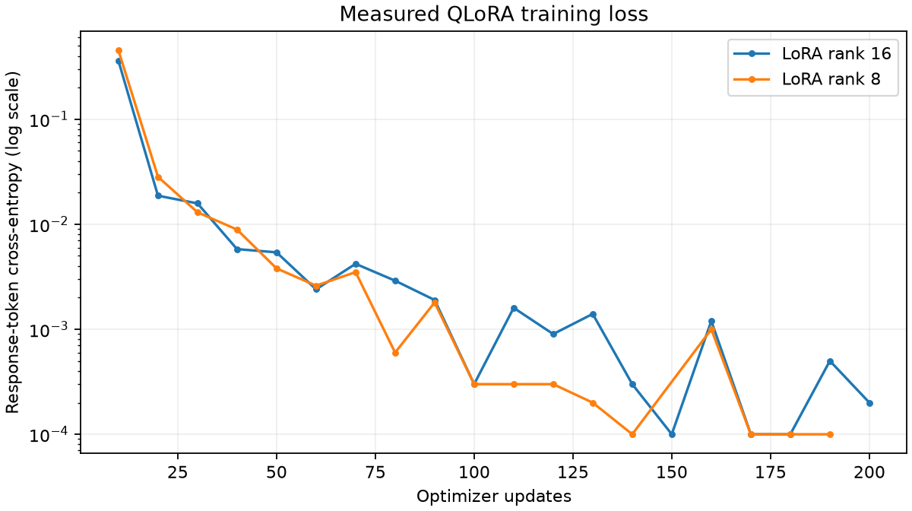

# Measured SSH Incident Extraction Results

This benchmark measures agreement with observable-event annotations. The rule baseline also generates those annotations, so its perfect agreement is expected. Independent expert ground truth and unseen-template generalization are not claimed.

| System | Incidents | Strict finding F1 | F1 after fence removal | Exact record | Valid schema | Canonical evidence F1 | Median seconds | Peak GPU MiB |
|---|---:|---:|---:|---:|---:|---:|---:|---:|
| rules | 93 | 1.000 | 1.000 | 1.000 | 1.000 | 1.000 | 0.0001 | 0 |
| original | 93 | 0.257 | 0.615 | 0.000 | 0.183 | 0.276 | 12.0833 | 1482 |
| adapter | 93 | 1.000 | 1.000 | 1.000 | 1.000 | 1.000 | 7.6831 | 1515 |

Adapter minus original finding F1: +0.743. Exact-record accuracy change: +1.000.

Training is useful only to the extent these results and the error analysis justify it. The deterministic parser remains a serious alternative for this constrained task.

## Extraction, evidence, and output reliability

| System | User accuracy | IP accuracy | Outcome accuracy | Host accuracy | Evidence precision | Evidence recall | Invalid output rate | Unsupported finding rate |
|---|---:|---:|---:|---:|---:|---:|---:|---:|
| rules | 1.000 | 1.000 | 1.000 | 1.000 | 1.000 | 1.000 | 0.000 | 0.000 |
| original | 0.118 | 0.183 | 0.183 | 0.183 | 0.500 | 0.190 | 0.817 | 0.140 |
| adapter | 1.000 | 1.000 | 1.000 | 1.000 | 1.000 | 1.000 | 0.000 | 0.000 |

Unsupported finding rate counts schema-valid responses with extra findings, divided by all incidents. Invalid responses fail the primary metrics and are reported separately; a low unsupported rate alone does not establish reliable output.

| System | Median seconds | p95 seconds | Peak allocated MiB | Peak reserved MiB |
|---|---:|---:|---:|---:|
| rules | 0.0001 | 0.0002 | 0 | 0 |
| original | 12.0833 | 16.3656 | 1482 | 2388 |
| adapter | 7.6831 | 10.9255 | 1515 | 2422 |

### Matched AC-power latency check

The full original-model test began on battery and continued on AC power. Its full-test timing is observational. For a fairer comparison, the following paired window was fixed after AC connection and before these incidents were processed: the last 20 test incidents, with batch size 1 for both systems.

| System | Matched incidents | Median seconds | p95 seconds | Mean generated tokens |
|---|---:|---:|---:|---:|
| original | 20 | 8.7614 | 11.7684 | 94.0 |
| adapter | 20 | 7.2068 | 9.9702 | 55.4 |

Response lengths and formatting can affect latency. This small, paired device measurement is not a production throughput benchmark.

## Training-run comparison

| Rank | Trainable parameters | Percent trainable | Minutes | Peak allocated / reserved MiB | Validation loss | Validation exact record | Validation finding F1 |
|---|---:|---:|---:|---:|---:|---:|---:|
| 16 | 17,432,576 | 1.00% | 28.59 | 3575 / 11732 | 0.00080 | 0.993 | 0.998 |
| 8 | 8,716,288 | 0.50% | 30.40 | 3442 / 11216 | 0.00131 | 0.993 | 1.000 |

Selected rank: **8**, using validation exact-record accuracy, then finding F1, schema validity, validation loss. Final test scores did not select this configuration.

Training loss alone does not establish generalization; use the held-out comparison above. Trainer logs round loss values; entries recorded as zero are omitted from this logarithmic plot.

## Dataset

Model: `Qwen/Qwen3-1.7B`. Maximum combined training length: 1024 tokens.
Partition counts after length filtering: `{'train': 1599, 'validation': 142, 'test': 93}`.
Dataset SHA-256: `17c2c0ad5db69aba0f4ea38619ae371cd2a5450b7b2ea925039ce29638bf792b`.

Long incidents are excluded rather than silently truncated. Balanced sampling changes the natural event frequencies; these are not production-prevalence estimates.

| Partition | Original incidents | Identity variations | Success | Failure | Unknown |
|---|---:|---:|---:|---:|---:|
| train | 1330 | 269 | 57 | 1239 | 303 |
| validation | 142 | 0 | 11 | 95 | 36 |
| test | 93 | 0 | 10 | 54 | 29 |

| Finding | Training incidents | Validation incidents | Test incidents |
|---|---:|---:|---:|
| invalid_user | 463 | 32 | 19 |
| password_authentication_failed | 1196 | 89 | 51 |
| authentication_accepted | 57 | 11 | 10 |
| too_many_authentication_failures | 250 | 24 | 12 |
| connection_closed | 1050 | 78 | 51 |
| insufficient_evidence | 201 | 30 | 20 |

## Metric interpretation

Canonical evidence F1 requires the reference line IDs. An alternative supporting line can be substantively correct but lose canonical-match credit; supported-citation rate is also recorded in the JSON metrics.
Malformed or schema-invalid output is a failed incident. Missing predictions are failures. Null-field accuracy includes correctly absent values.
A secondary content diagnostic removes only exact outer Markdown fences, without extracting objects from prose or repairing JSON. It separates formatting compliance from extraction quality; its rule was fixed using validation before the final test.
Peak memory is PyTorch allocated memory, not total GPU process memory. Timing excludes model loading and a fixed synthetic warm-up; inference is sequential with batch size 1.
Reserved memory includes allocator cache and can be substantially larger than allocated tensors. Training time includes the epoch-end validation and adapter save; inference runs and initial model loading are outside that measurement.
P95 latency uses the nearest-rank percentile.

## Limits

- One historical lab source, small test set, shared event templates, and rule-derived references limit generalization claims.
- Host/PID/idle-gap sessionization is approximate. Orphaned lines can occur after disconnect events.
- Findings describe observable events; attack intent and hidden root causes are outside the label taxonomy.
- Final test results are not used to select prompts, hyperparameters, or checkpoints.
